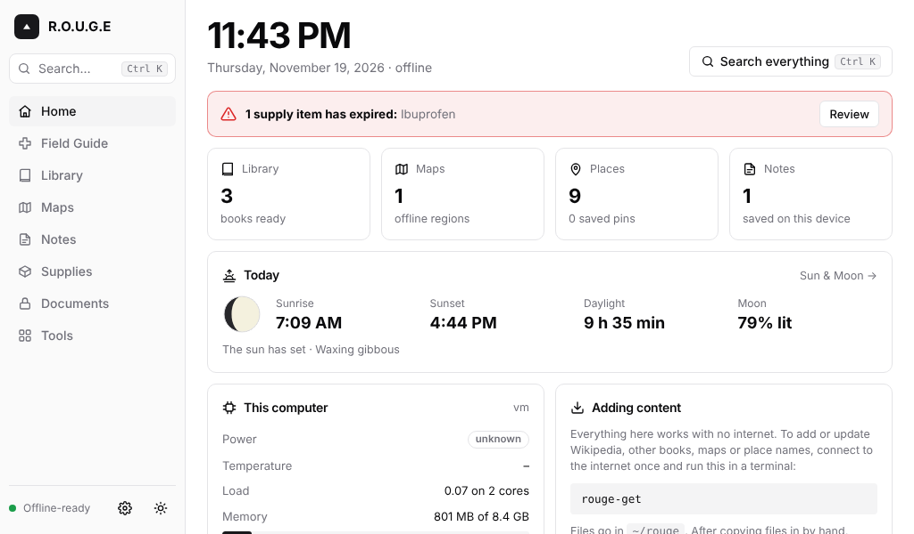
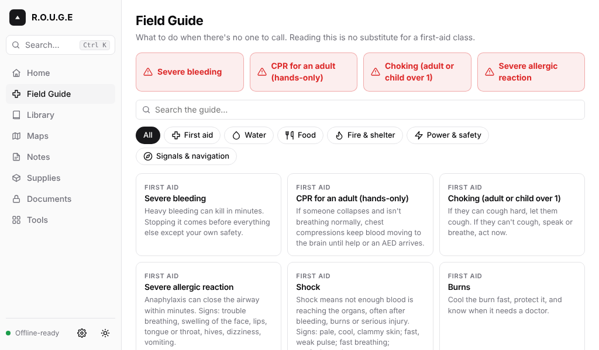
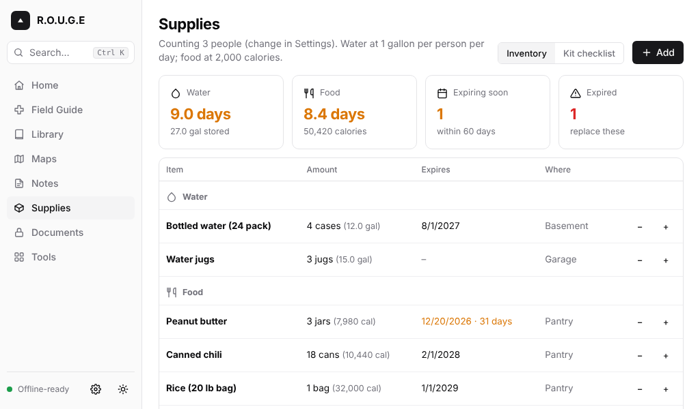
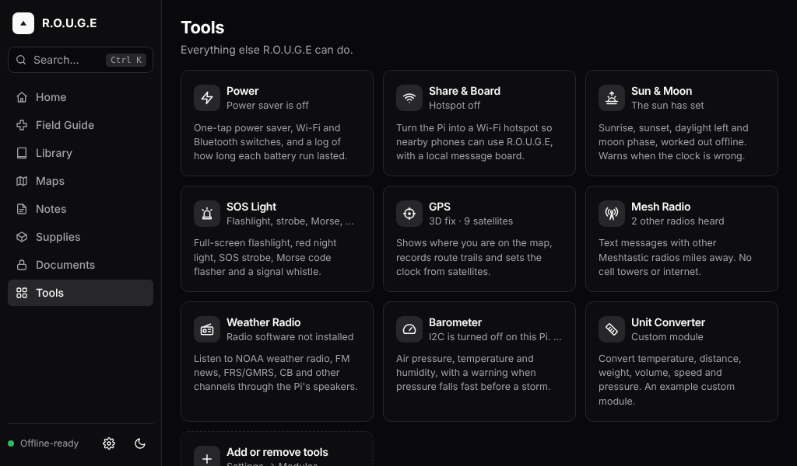
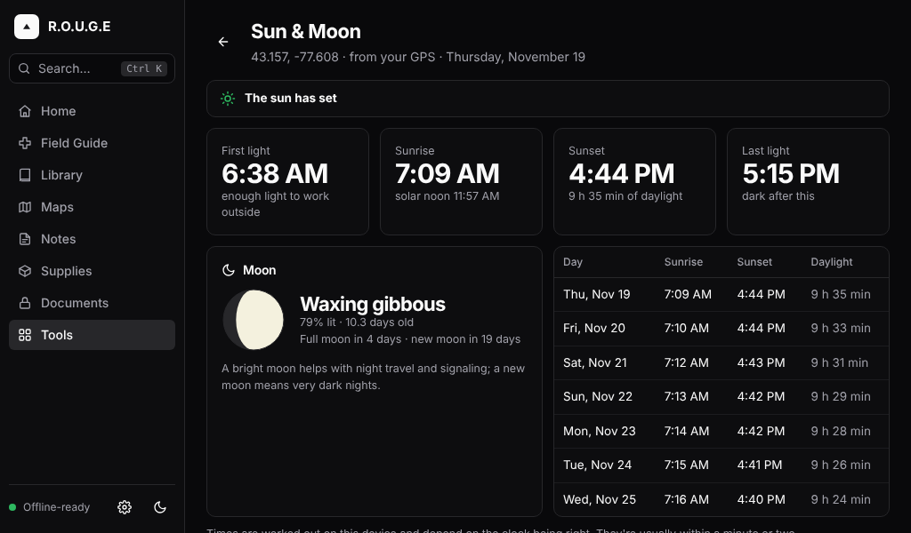
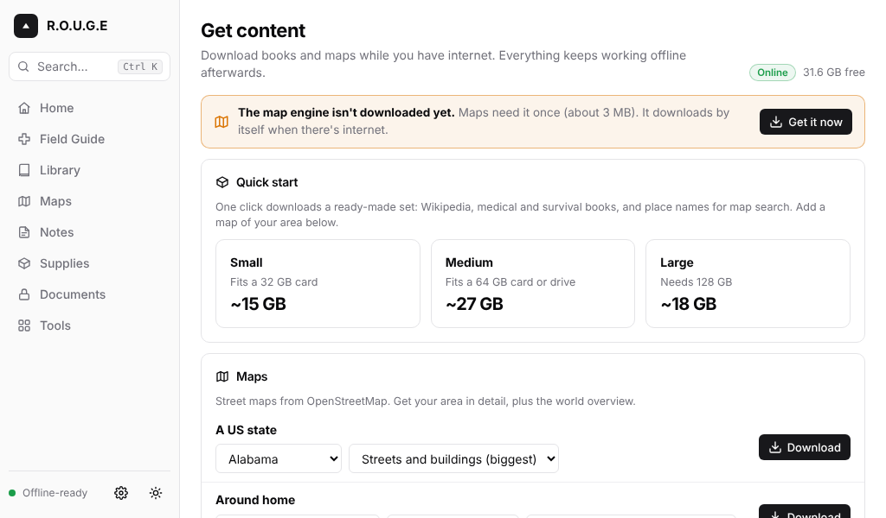
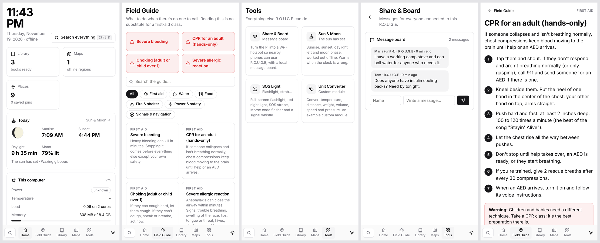

# R.O.U.G.E

**An offline survival computer for the Raspberry Pi.** Wikipedia, maps, a first-aid and survival field guide, and tools for when the power grid and the internet are down. It runs on a Pi 4 or 5 (or a Zero 2 W) from a power bank, and phones nearby can use it too.



## What it does

Everything works with no internet once content is downloaded. Every feature is a **module** you can turn on or off. You can also [write your own](MODULES.md).

| Module | What you get |
|---|---|
| **Library** (core) | Wikipedia, WikiMed, survival manuals, iFixit, a dictionary and more through Kiwix. Instant title search across every book, plus full-text search. |
| **Maps** (core) | Street-level OpenStreetMap maps of any area. Search towns, drop pins, measure distances, find the nearest hospital, pharmacy, water or shelter, and read coordinates as decimal, DMS, UTM or MGRS. |
| **Notes** (core) | Saved as you type, as plain files. |
| **Field Guide** | 26 quick cards: bleeding, CPR, choking, burns, hypothermia, heat stroke, water purification (with bleach amounts), food safety, fire, shelter, signals, navigation, carbon monoxide, generators and radio frequencies. Each card names its source: CDC, EPA, Ready.gov, Red Cross, AHA or the U.S. Army field manuals. |
| **Supplies** | Tracks water, food, medicine and batteries. Shows how many days your household can last and warns before things expire. Includes the Ready.gov kit checklist. |
| **Documents** | IDs, insurance, prescriptions and records, encrypted with AES-256 and a password. |
| **Power** | Power-saver mode, Wi-Fi and Bluetooth switches, brightness, under-voltage warnings, and a log of how long each battery run lasted. |
| **Share & Board** | Turns the Pi into a Wi-Fi hotspot so nearby phones can read the guide, library and maps, with a local message board. Notes, documents and settings stay private. |
| **Sun & Moon** | Sunrise, sunset, first and last light, daylight left and moon phase, computed offline. Warns when the clock is wrong. |
| **SOS Light** | Flashlight, red night light, SOS strobe, Morse code message flasher and a signal whistle. |
| **GPS** *(USB GPS receiver)* | Shows you on the map, records trails (exportable as GPX) and sets the clock from satellites. |
| **Mesh Radio** *(Meshtastic LoRa radio)* | Text messages with other Meshtastic radios miles away. No towers needed. |
| **Weather Radio** *(RTL-SDR dongle)* | NOAA weather radio, FM news, FRS/GMRS, CB and marine channels through the speakers. |
| **Barometer** *(BME280/BMP280 sensor)* | Pressure, temperature and humidity, with a storm warning when pressure falls fast. |

It's one small Go program (about 7 MB, standard library only) plus a plain-JavaScript interface in a shadcn/ui style. Idle, it uses almost no CPU, so the browser and screen are where your battery goes.

| | |
|---|---|
|  |  |
|  |  |

## Install

You need Raspberry Pi OS Bookworm or newer (64-bit recommended, with the desktop) and internet **once**.

**One line:**

```sh
curl -fsSL https://raw.githubusercontent.com/RRougeX/rouge/main/get.sh | bash
```

**Or from a download** (for example, copied over on a flash drive): unzip it, open the `rouge` folder, and run `./install.sh` in a terminal.

The installer asks how you want to install:

- **Full install:** every module. Recommended, and it asks no more questions.
- **Custom:** a checklist with every module ticked. Untick what you don't want.

It then sets the Pi up as an appliance:

- it logs in to the desktop by itself;
- R.O.U.G.E opens full screen when the Pi is switched on;
- R.O.U.G.E waits until it's ready, so the window never shows an error;
- there's no "restore pages?" prompt after you pull the power.

Press **F11** to leave full screen. Turn start-at-power-on off any time in **Settings**.

## Getting books and maps

Open **Get content** inside R.O.U.G.E (on the Library page, Home, or with Ctrl+K) while the Pi has internet:

- **Quick start sets:**
  - **Small:** about 15 GB, for a 32 GB card.
  - **Medium:** about 27 GB, for a 64 GB drive.
  - **Large:** for 128 GB.
- **Maps:**
  - a US state, or an area around your home, at the level of detail you choose;
  - the world overview.
- **One at a time:** any Wikipedia size, WikiMed, survival manuals, iFixit, a dictionary and more.

Downloads show progress, continue where they stopped if the connection drops, and replace older versions automatically. The map engine downloads and repairs itself whenever it's missing and there's internet.



Prefer a terminal? `rouge-get` does the same thing.

## Changing modules later

- **Settings → Modules** inside R.O.U.G.E turns modules on or off instantly.
- **`rouge-setup`** shows the checklist again and installs anything a newly ticked module needs (with internet).
- **`rouge-setup add <folder | file.zip | git URL>`** adds a custom module.
- **`rouge-setup remove <id>`**, **`rouge-setup list`** and **`rouge-setup uninstall`** do what they say. Uninstalling keeps your data.

See **[MODULES.md](MODULES.md)** to build your own module. It's a folder with a `module.json` and a web page. An example unit converter is included.

## Storage guide

| Card or drive | What fits |
|---|---|
| 32 GB | Wikipedia "intro of every article" or "top 50,000", WikiMed, manuals, a state map |
| 128 GB | Full Wikipedia without pictures, plus all of the above |
| 256 GB or more | Wikipedia with pictures |

ZIM files go in `~/rouge/zim` and maps (`.pmtiles`) in `~/rouge/maps`. Press **Rescan** in the Library after copying files by hand. To copy big files from a PC by flash drive, format the drive as exFAT: FAT32 can't hold files over 4 GB.

## Sharing with phones when the grid is down

Open **Tools → Share & Board** and turn on the hotspot. Phones join the network shown there and open `http://10.42.0.1:8080`.

- **Guests can use:** the guide, library, maps, sun and moon, SOS light and the message board.
- **Kept private to the device:** notes, supplies, documents, power and settings.



## Power tips

- Screen brightness matters most.
- Turn on Power saver.
- Close the Maps page when you're done with it.
- A red under-voltage badge means the power bank or cable can't keep up. Use a short, thick USB-C cable, and check the bank's low-current mode.

## Troubleshooting

```sh
systemctl status rouge         # running?
journalctl -u rouge -n 50      # recent messages
sudo systemctl restart rouge
rouge-setup                    # re-run setup, e.g. after getting internet
```

## Building from source

The code is in `server/`. It needs Go 1.24 or newer and has no other dependencies.

```sh
make            # tests, then builds bin/ for Pi 64-bit, Pi 32-bit and PC
make release    # dist/rouge.tar.gz, the file GitHub releases ship
```

The web interface is plain HTML, CSS and JavaScript in `server/web/`, embedded into the binary. There's no build step.

## Safety

The Field Guide is a quick reference, not training or medical advice. Take a first-aid and CPR class. In an emergency, call for help if any way to call exists.

## Credits and licences

- R.O.U.G.E code: MIT licence (see [LICENSE](LICENSE)).
- Content you download has its own licences:
  - Wikipedia and Wikimedia projects (CC BY-SA), served by Kiwix;
  - OpenStreetMap (ODbL), via Protomaps;
  - GeoNames (CC BY).
- Map rendering: MapLibre GL JS and PMTiles, downloaded at install time.
- Field Guide text is written for this project from public-domain U.S. government sources and the organisations named on each card.
